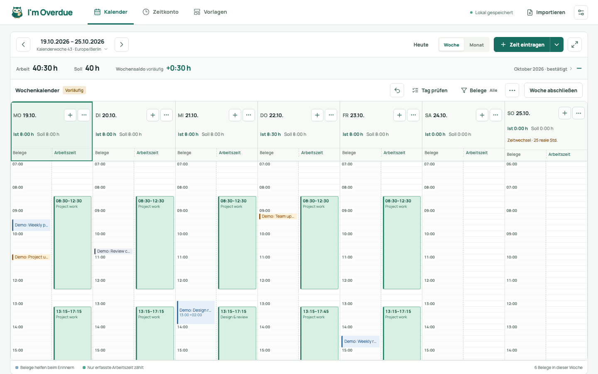

<p align="center"></p>

<h1 align="center">I'm Overdue</h1>

<p align="center"><strong>Deine Arbeit. Deine Zeit. Dein Überblick.</strong></p>

<p align="center">
  <a href="https://github.com/ill-yes/im-overdue/actions/workflows/ci.yml"></a>
  <a href="https://github.com/ill-yes/im-overdue/releases/latest"></a>
</p>

<p align="center">
  <a href="#lokal-starten"></a>
  <a href="docs/de/docker.md"></a>
  <a href="https://github.com/ill-yes/im-overdue/pkgs/container/im-overdue"></a>
  <a href="LICENSE"></a>
</p>

<p align="center">
  <a href="README.md"></a>
  <a href="https://buymeacoffee.com/ill_yes"></a>
</p>

<p align="center"><a href="README.md">English</a> · <a href="README.de.md">Deutsch</a></p>

<p align="center">
  <a href="#mit-docker-starten">🚀 Loslegen</a> · <a href="#screenshots">👀 Einblick</a> · <a href="#funktionen">✨ Funktionen</a> · <a href="#dokumentation">📚 Dokumentation</a> · <a href="#status">🧪 Status</a> · <a href="#im-overdue-unterstützen">☕ Unterstützen</a>
</p>

Nach einer vollen Woche ist nicht immer klar, wo die Zeit geblieben ist.
I'm Overdue gibt deiner Arbeit einen übersichtlichen Platz: ein persönliches
Zeitkonto auf deinem eigenen Rechner oder Server, mit Aktivitäten, erfassten
Stunden und Saldo an einem Ort.

Vergleiche Aktivitäten aus deinen Kalender-, Slack- und GitHub-Exporten mit
der Arbeitszeit, die du selbst erfasst. Dafür importierst du normalisierte
JSON-/CSV-Dateien aus eigenen Exportern; die App verbindet sich nicht mit den
APIs dieser Dienste. Keine Cloud, keine Fremddienst-Zugangsdaten, keine
automatische Zeiterfassung.

<a id="screenshots"></a>

## 👀 Einblick



*Die echte App mit synthetischen Beispieldaten. Importierte Aktivitäten helfen
beim Erinnern; Arbeitszeit erfasst du selbst.*

<a id="funktionen"></a>

## ✨ Was du damit machen kannst

| Funktion | Was sie dir ermöglicht |
| --- | --- |
| 📅 **Deine Arbeitswoche** | Wochen- und Monatskalender, genaue Zeiteingabe und wiederverwendbare Vorlagen. |
| ⚖️ **Zeitkonto** | Anfangsbestand, bearbeitbare Auszahlungen und Korrekturen; bestätigte, offene und zukünftige Werte bleiben getrennt. |
| 🌿 **Abwesenheiten** | Urlaub, Freizeitausgleich und Krankheit kombinieren; datierte Bundeslandregeln und einzelne Feiertagsausnahmen beachten dein Soll. |
| 🔌 **Aktivitätsimporte** | Belege aus eigenen normalisierten JSON-/CSV-Dateien in benannte Quellen übernehmen, mit Zuordnung, Vorschau und Importhistorie. |
| 📄 **Exporte & Backups** | Druckbare Stundenzettel mit optionalem Kontoteil, separate Zeitkonto-CSV und SQLite-Backups. |
| 🌐 **Deine Sprache** | Englisch als Standard, mit **English / Deutsch** auf der Login-Seite und in den Einstellungen. |
| 🏠 **Selbst hosten** | Ein Docker-Container für Oberfläche, API und SQLite, mit AMD64- und ARM64-Unterstützung. |

<a id="mit-docker-starten"></a>

## 🚀 Mit Docker starten

Das öffentliche Image `ghcr.io/ill-yes/im-overdue:latest` enthält die App und ihre
Datenbank-Engine. Docker wählt das passende AMD64- oder ARM64-Image.

**Du brauchst:** Docker Engine oder Docker Desktop mit Compose v2 sowie `curl`.
Bereite für entfernten Zugriff einen HTTPS-Reverse-Proxy vor; siehe
[Docker-/Unraid-Anleitung](docs/de/docker.md).

### 1. Konfiguration herunterladen

Lege einen neuen Installationsordner an und lade seine beiden Konfigurationsdateien herunter:

```sh
mkdir im-overdue &&
cd im-overdue &&
curl -fsSL https://raw.githubusercontent.com/ill-yes/im-overdue/main/compose.yaml -o compose.yaml &&
curl -fsSL https://raw.githubusercontent.com/ill-yes/im-overdue/main/.env.example -o .env &&
chmod 600 .env
```

### 2. Adresse und Passwort festlegen

Bearbeite `.env` und fülle beide Pflichtwerte aus:

- **`IM_OVERDUE_ORIGIN`:** Deine genaue Browseradresse, z. B.
  `http://192.168.1.20:4317` oder `https://zeit.example.net`, ohne Pfad oder abschließenden Schrägstrich.
- **`IM_OVERDUE_PASSWORD`:** Ein eigenes Passwort mit 12–256 Zeichen; setze es
  in einfache Anführungszeichen, damit `$` und `#` unverändert bleiben.

### 3. Starten und anmelden

Führe diese Befehle im Installationsordner aus:

```sh
docker compose pull
docker compose up -d --no-build
```

Öffne die konfigurierte Adresse und melde dich an. Deine Daten liegen unter
`./appdata`, getrennt von lokalen Entwicklungsdaten. Nutze für entfernten Zugriff
HTTPS über deinen Reverse Proxy; HTTP überträgt Passwort und Daten unverschlüsselt.

[Image-Version wählen](docs/de/docker.md#image-versionen) ·
[Unraid einrichten](docs/de/docker.md#unraid) ·
[Installation aktualisieren](docs/de/docker.md#passwort-ändern-und-aktualisieren) ·
[Sichern und wiederherstellen](docs/de/docker.md#backup-und-offline-wiederherstellung)

<a id="lokal-starten"></a>

## 💻 Lokal starten

Voraussetzung: Node.js 24 oder neuer und npm.

```sh
npm ci
npm run dev
```

Öffne `http://127.0.0.1:4317`. Der lokale Standardbetrieb bindet nur an Loopback
und benötigt kein Passwort. Für einen Produktionsbuild zuerst `npm run build`,
dann `npm start` ausführen. Konfiguration und Tests stehen unter
[Entwicklung](docs/de/development.md).

<a id="erste-schritte"></a>

## 📅 Erste Schritte

1. Prüfe Zeitzone, Wochenstunden und Arbeitstage in den Einstellungen. Ergänze
   bei Bedarf unter **Feiertage** dein Bundesland und prüfe lokale Ausnahmen.
2. Lege unter **Zeitkonto → Stundenkonto** Anfangsdatum und Bestand fest, wenn du
   ein laufendes Konto möchtest. Null ist ein gültiger Anfangsbestand.
3. Erfasse deinen ersten Arbeitsblock und **Abwesenheiten** im Kalender. Du kannst
   ohne Import beginnen.
4. Prüfe und schließe fertige Wochen ab. Exportiere bei Bedarf einen Stundenzettel.

**Optional: Belege mitbringen.** Lege benannte Datenquellen an, analysiere eine
Aktivitätsdatei, ordne ihre Quellentypen zu und prüfe die Vorschau vor dem Speichern.
Aktivitäten helfen beim Erinnern; sie erzeugen nie automatisch Arbeitszeit.

Die [Anleitung für einen Arbeitstag](docs/de/usage.md#einen-arbeitstag-erfassen)
erklärt die Schritte samt Schnellerfassung, Pausen und genauen Uhrzeiten.

<a id="status"></a>

## 🧪 Kompatibilität & Status

| Bereich | Was du erwarten kannst |
| --- | --- |
| Betrieb | Selbst gehostet; ein Docker-Container enthält Oberfläche, API und SQLite. AMD64 und ARM64 werden unterstützt. |
| Aktivitätsimporte | Eigene normalisierte JSON-/CSV-Exporte; keine direkte Anbindung an Kalender-, Slack- oder GitHub-APIs. |
| Zeiterfassung | Du erfasst Arbeitszeit selbst. Importierte Aktivitäten erzeugen nie automatisch Arbeitszeit. |
| Prüfungen & Releases | [CI-Prüfungen](https://github.com/ill-yes/im-overdue/actions/workflows/ci.yml) laufen auf `main` und für Pull Requests. [Releases](https://github.com/ill-yes/im-overdue/releases) werden über den manuellen Release-Workflow veröffentlicht. |

<a id="dokumentation"></a>

## 📚 Finde deinen Weg

Starte mit dem, was du erledigen möchtest:

| Ich möchte… | Hier geht es los |
| --- | --- |
| 🚀 Installieren und selbst hosten | [Docker und Unraid](docs/de/docker.md). |
| 🔧 Betrieb und Wartung erledigen | [Befehle im Alltag](docs/de/docker.md#befehle-im-alltag), [Updates](docs/de/docker.md#passwort-ändern-und-aktualisieren) und [Backups](docs/de/docker.md#backup-und-offline-wiederherstellung). |
| 📅 Arbeitszeit erfassen und prüfen | [I'm Overdue verwenden](docs/de/usage.md). |
| ⚖️ Konto und Abwesenheiten verwalten | [Stundenkonto](docs/de/usage.md#stundenkonto), [Abwesenheiten](docs/de/usage.md#abwesenheiten) und [Feiertage](docs/de/usage.md#feiertage). |
| 🔌 Aktivitätsimporte vorbereiten | [JSON-/CSV-Format und Exporter-Anleitung](docs/de/import-format.md). |
| 🛠️ Entwickeln und beitragen | [Entwicklung](docs/de/development.md). |

Die [Doku-Zentrale](docs/de/README.md) bündelt diese Wege und schnelle Hilfelinks,
wenn du eine Lösung suchst.

<a id="entwicklung"></a>

## 🛠️ Entwickeln & beitragen

Die [Entwickleranleitung](docs/de/development.md) beschreibt lokale Konfiguration,
Builds und Tests. Lies vor einem Änderungsvorschlag die
[Beitragsbedingungen](CONTRIBUTING.md). Fehler und Ideen gehören in
[GitHub Issues](https://github.com/ill-yes/im-overdue/issues).
Sicherheitslücken meldest du bitte vertraulich, wie in der
[Sicherheitsrichtlinie](SECURITY.md) beschrieben.

<a id="lizenz"></a>

## 📄 Lizenz

I'm Overdue steht einschließlich Quellcode, Templates und Metadaten unter der
[MIT-Lizenz](LICENSE). Hinweise zu Lizenzen Dritter stehen in [NOTICE](NOTICE),
die Beitragsbedingungen in [CONTRIBUTING.md](CONTRIBUTING.md).

<a id="im-overdue-unterstützen"></a>

## ☕ I'm Overdue unterstützen

Wenn I'm Overdue deine Woche etwas leichter macht, kannst du mir einen Kaffee
spendieren. Die Unterstützung ist ganz freiwillig. Danke, dass du dir hier
etwas Zeit nimmst.

[](https://buymeacoffee.com/ill_yes)
