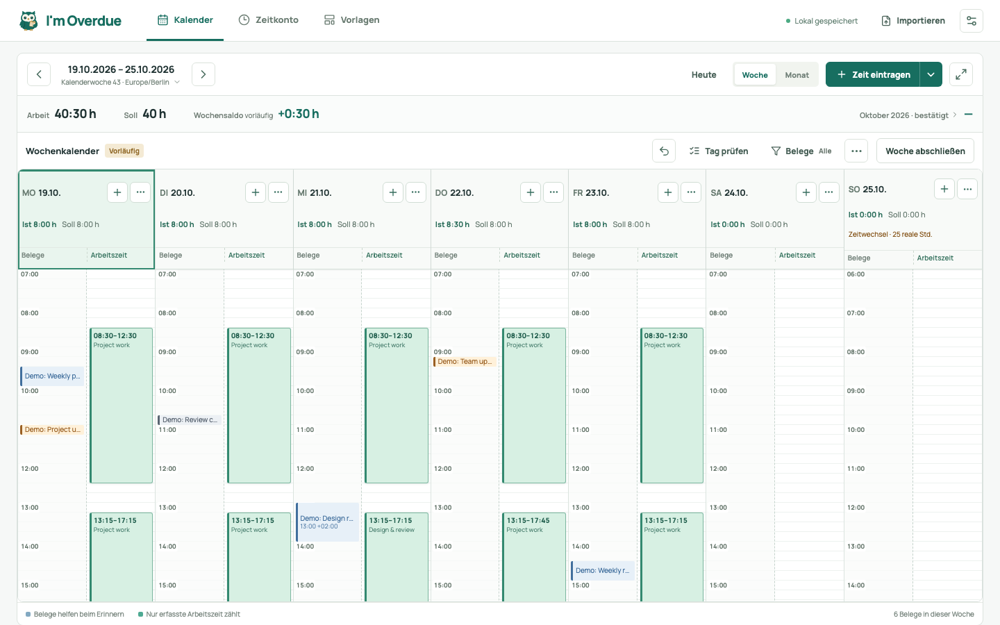

<p align="center"></p>

<h1 align="center">I'm Overdue</h1>

<p align="center"><strong>Deine Arbeit. Deine Zeit. Dein Überblick.</strong></p>

<p align="center">
  <a href="https://github.com/ill-yes/im-overdue/actions/workflows/ci.yml"></a>
  <a href="LICENSE"></a>
  <a href="#lokal-starten"></a>
</p>

<p align="center">
  <a href="docs/de/docker.md"></a>
  <a href="README.de.md"></a>
  <a href="https://buymeacoffee.com/ill_yes"></a>
</p>

<p align="center"><a href="README.md">English</a> · <a href="README.de.md">Deutsch</a></p>

<p align="center">
  <strong>Direkt zu</strong><br />
  <a href="#mit-docker-starten">🚀 Loslegen</a> · <a href="#screenshots">👀 Einblick</a> · <a href="#funktionen">✨ Funktionen</a> · <a href="#erste-schritte">📅 So funktioniert's</a> · <a href="#dokumentation">📚 Dokumentation</a> · <a href="#im-overdue-unterstützen">☕ Unterstützen</a>
</p>

Nach einer vollen Woche ist nicht immer klar, wo die Zeit geblieben ist.
I'm Overdue gibt deiner Arbeit einen übersichtlichen Platz: ein persönliches
Zeitkonto auf deinem eigenen Rechner oder Server, mit Aktivitäten, erfassten
Stunden und Saldo an einem Ort.

Vergleiche Aktivitäten aus deinen Kalender-, Slack- und GitHub-Exporten mit
der Arbeitszeit, die du selbst erfasst. Dafür importierst du normalisierte
JSON-/CSV-Dateien aus eigenen Exportern; die App verbindet sich nicht mit den
APIs dieser Dienste. Keine Cloud, keine Fremddienst-Zugangsdaten, keine
automatische Zeiterfassung.

## Screenshots



*Die echte App mit synthetischen Beispieldaten. Importierte Aktivitäten helfen
beim Erinnern; Arbeitszeit erfasst du selbst.*

## Funktionen

- **📅 Die Woche im Blick.** Wochen- und Monatskalender, genaue Zeiteingabe und
  wiederverwendbare Vorlagen.
- **⚖️ Dein Saldo bleibt klar.** Anfangsbestand, bearbeitbare Auszahlungen und
  Korrekturen; bestätigte, offene und zukünftige Werte bleiben getrennt.
- **🌿 Abwesenheiten planen.** Urlaub, Freizeitausgleich und Krankheit kombinieren;
  datierte Bundeslandregeln und einzelne Feiertagsausnahmen beachten dein Soll.
- **🔌 Belege an einem Ort.** Benannte Datenquellen mit JSON-/CSV-Zuordnung,
  Vorschau und Importhistorie.
- **📄 Unterlagen zum Mitnehmen.** Druckbare Stundenzettel mit optionalem Kontoteil,
  separate Zeitkonto-CSV und SQLite-Backups.
- **Deine Sprache.** Englisch als Standard; **English / Deutsch** auf der
  Login-Seite und in den Einstellungen.
- **Bei dir zu Hause.** Ein Docker-Container für Oberfläche, API und SQLite;
  AMD64 und ARM64 unterstützt.

## Mit Docker starten

Installiere Docker mit Compose und führe im Projektverzeichnis aus:

```sh
cp .env.example .env
chmod 600 .env
```

Bearbeite `.env`: Trage unter `IM_OVERDUE_ORIGIN` die genaue Browseradresse ein,
zum Beispiel `http://192.168.1.20:4317`, und wähle ein eigenes
`IM_OVERDUE_PASSWORD` mit 12–256 Zeichen. Setze das Passwort in `.env` in einfache
Anführungszeichen, damit `$` und `#` unverändert bleiben.

```sh
docker compose up -d --build
```

Öffne die konfigurierte Adresse und melde dich an. Deine Daten liegen unter
`./appdata`, getrennt von lokalen Entwicklungsdaten. Nutze für entfernten Zugriff
HTTPS über deinen Reverse Proxy; HTTP überträgt Passwort und Daten unverschlüsselt.

Die [Docker-/Unraid-Anleitung](docs/de/docker.md) erklärt Rechte, HTTPS,
Passwortwechsel, Updates, Backups und Offline-Wiederherstellung.

## Lokal starten

Voraussetzung: Node.js 24 oder neuer und npm.

```sh
npm ci
npm run dev
```

Öffne `http://127.0.0.1:4317`. Der lokale Standardbetrieb bindet nur an Loopback
und benötigt kein Passwort. Für einen Produktionsbuild zuerst `npm run build`,
dann `npm start` ausführen. Konfiguration und Tests stehen unter
[Entwicklung](docs/de/development.md).

## Erste Schritte

1. Prüfe Zeitzone, Wochenstunden und Arbeitstage in den Einstellungen. Ergänze
   bei Bedarf unter **Feiertage** dein Bundesland und prüfe lokale Ausnahmen.
2. Lege unter **Zeitkonto → Stundenkonto** Anfangsdatum und Bestand fest, wenn du
   ein laufendes Konto möchtest. Null ist ein gültiger Anfangsbestand.
3. Erfasse deinen ersten Arbeitsblock und **Abwesenheiten** im Kalender. Du kannst
   ohne Import beginnen.
4. Prüfe und schließe fertige Wochen ab. Exportiere bei Bedarf einen Stundenzettel.

**Optional: Belege mitbringen.** Lege benannte Datenquellen an, analysiere eine
Aktivitätsdatei, ordne ihre Quellentypen zu und prüfe die Vorschau vor dem Speichern.
Aktivitäten helfen beim Erinnern; sie erzeugen nie automatisch Arbeitszeit.

Die [Anleitung für einen Arbeitstag](docs/de/usage.md#einen-arbeitstag-erfassen)
erklärt die Schritte samt Schnellerfassung, Pausen und genauen Uhrzeiten.

## Dokumentation

Starte mit dem, was du erledigen möchtest:

- **🚀 Installieren und selbst hosten:** [Docker und Unraid](docs/de/docker.md).
- **📅 Arbeitszeit erfassen und prüfen:** [I'm Overdue verwenden](docs/de/usage.md).
- **⚖️ Konto und Abwesenheiten verwalten:** [Stundenkonto](docs/de/usage.md#stundenkonto),
  [Abwesenheiten](docs/de/usage.md#abwesenheiten) und [Feiertage](docs/de/usage.md#feiertage).
- **🔌 Aktivitätsimporte vorbereiten:** [JSON-/CSV-Format und Exporter-Anleitung](docs/de/import-format.md).
- **🛠️ Entwickeln und beitragen:** [Entwicklung](docs/de/development.md).

Die [Doku-Zentrale](docs/de/README.md) bündelt diese Wege und schnelle Hilfelinks,
wenn du eine Lösung suchst.

## Lizenz

I'm Overdue ist unter der
[PolyForm Noncommercial License 1.0.0](LICENSE)
(`PolyForm-Noncommercial-1.0.0`) source-available, keine OSI-anerkannte
Open-Source-Software. Die Lizenz erlaubt nichtkommerzielle Nutzung, Änderungen
und Weitergabe unter ihren Bedingungen.

Siehe [NOTICE](NOTICE) für erforderliche Hinweise,
[kommerzielle Lizenzierung](COMMERCIAL-LICENSE.md) für Nutzungen außerhalb der
Standardlizenz und [Beiträge](CONTRIBUTING.md) für die Beitragsbedingungen.

## I'm Overdue unterstützen

Du hast einen Fehler gefunden, eine Idee oder möchtest mithelfen? Nutze
[GitHub Issues](https://github.com/ill-yes/im-overdue/issues) oder schau in die
[Beitragsbedingungen](CONTRIBUTING.md).

Wenn I'm Overdue deine Woche etwas leichter macht, kannst du mir einen Kaffee
spendieren. Die Unterstützung ist ganz freiwillig. Danke, dass du dir hier
etwas Zeit nimmst.

[](https://buymeacoffee.com/ill_yes)
