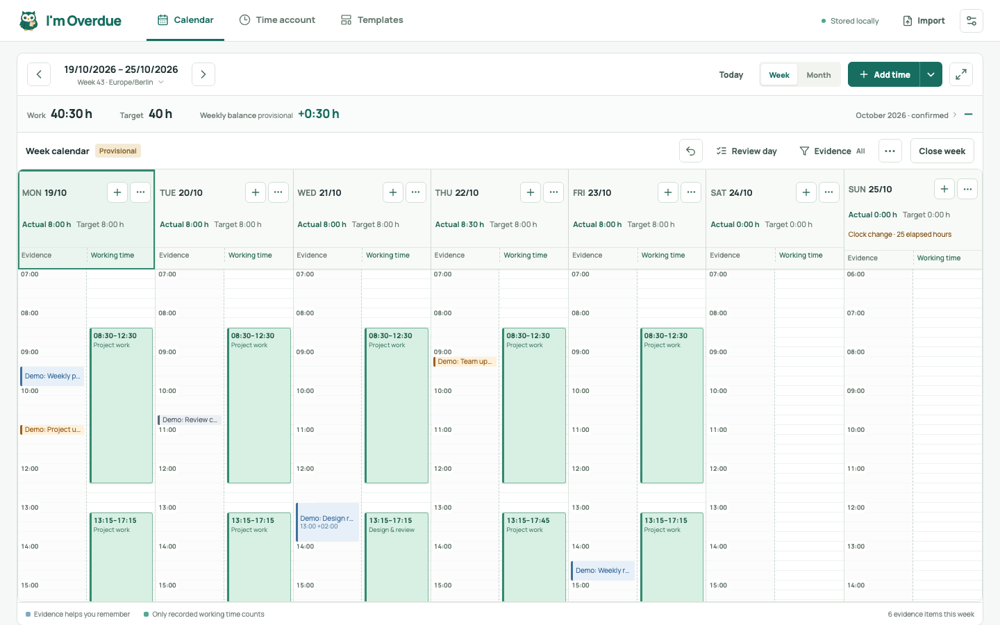

<p align="center"></p>

<h1 align="center">I'm Overdue</h1>

<p align="center"><strong>Your work. Your time. A clearer week.</strong></p>

<p align="center">
  <a href="https://github.com/ill-yes/im-overdue/actions/workflows/ci.yml"></a>
  <a href="https://github.com/ill-yes/im-overdue/releases/latest"></a>
</p>

<p align="center">
  <a href="#start-locally"></a>
  <a href="docs/docker.md"></a>
  <a href="https://github.com/ill-yes/im-overdue/pkgs/container/im-overdue"></a>
  <a href="LICENSE"></a>
</p>

<p align="center">
  <a href="README.de.md"></a>
  <a href="https://buymeacoffee.com/ill_yes"></a>
</p>

<p align="center"><a href="README.md">English</a> · <a href="README.de.md">Deutsch</a></p>

<p align="center">
  <a href="#start-with-docker">🚀 Get started</a> · <a href="#screenshots">👀 Take a look</a> · <a href="#features">✨ Features</a> · <a href="#documentation">📚 Documentation</a> · <a href="#status">🧪 Status</a> · <a href="#support-im-overdue">☕ Support</a>
</p>

A busy week can be hard to piece together. I'm Overdue gives your work a
clearer home: a personal time account on your own machine or server, with
your activities, recorded hours and balance in one place.

Compare activity from your calendar, Slack and GitHub exports with the working
time you record yourself. Import normalized JSON/CSV files from your own
exporters; the app does not connect to those services’ APIs. No cloud service,
service credentials or automatic tracking.

<a id="screenshots"></a>

## 👀 Take a look



*The real app with synthetic example data. Imported activities help you remember;
you record working time yourself.*

<a id="features"></a>

## ✨ What you can do

| Feature | What it does |
| --- | --- |
| 📅 **Your working week** | Week and month calendars, precise time entry and reusable templates. |
| ⚖️ **Time account** | An opening balance, editable payouts and corrections; confirmed, open and future amounts stay separate. |
| 🌿 **Absences** | Combine vacation, time off in lieu and sickness; dated German state holiday rules and individual exceptions respect your working-time target. |
| 🔌 **Activity imports** | Bring evidence from your own normalized JSON/CSV files into named sources, with assignment, previews and import history. |
| 📄 **Exports & backups** | Printable timesheets with an optional account section, separate account CSV and SQLite backups. |
| 🌐 **Your language** | English by default, with **English / Deutsch** on the login page and in settings. |
| 🏠 **Self-hosting** | One Docker container for the UI, API and SQLite, with AMD64 and ARM64 support. |

<a id="start-with-docker"></a>

## 🚀 Start with Docker

The public image `ghcr.io/ill-yes/im-overdue:latest` includes the app and its
database engine. Docker selects the matching AMD64 or ARM64 image.

**You will need:** Docker Engine or Docker Desktop with Compose v2, and `curl`.
For remote access, prepare an HTTPS reverse proxy; see the
[Docker and Unraid guide](docs/docker.md).

### 1. Download the configuration

Create a new installation folder and download its two configuration files:

```sh
mkdir im-overdue &&
cd im-overdue &&
curl -fsSL https://raw.githubusercontent.com/ill-yes/im-overdue/main/compose.yaml -o compose.yaml &&
curl -fsSL https://raw.githubusercontent.com/ill-yes/im-overdue/main/.env.example -o .env &&
chmod 600 .env
```

### 2. Set your address and password

Edit `.env` and fill in both required values:

- **`IM_OVERDUE_ORIGIN`:** Your exact browser address, e.g.
  `http://192.168.1.20:4317` or `https://time.example.net`, without a path or trailing slash.
- **`IM_OVERDUE_PASSWORD`:** A unique password of 12–256 characters; put it in
  single quotes to preserve `$` and `#` literally.

### 3. Start and sign in

Run these commands in the installation folder:

```sh
docker compose pull
docker compose up -d --no-build
```

Open the configured address and sign in. Data is stored in `./appdata`, separate
from local development data. Use HTTPS through your reverse proxy for remote
access; HTTP sends your password and data without encryption.

[Choose an image version](docs/docker.md#image-versions) ·
[Set up Unraid](docs/docker.md#unraid) ·
[Update an installation](docs/docker.md#change-the-password-or-update) ·
[Back up and restore](docs/docker.md#backup-and-offline-restore)

<a id="start-locally"></a>

## 💻 Start locally

Requires Node.js 24 or newer and npm:

```sh
npm ci
npm run dev
```

Open `http://127.0.0.1:4317`. The default local mode listens only on loopback and
does not require a password. For a production build, run `npm run build` followed
by `npm start`. See [development](docs/development.md) for configuration and tests.

<a id="first-steps"></a>

## 📅 First steps

1. Check your time zone, weekly target and working days in settings. If applicable,
   add your German state under **Public holidays** and review local exceptions.
2. Set an opening date and balance under **Time account → Hours account** if you
   want a running account. Zero is a valid starting balance.
3. Record your first work block and any **Absences** in the calendar. You can
   start without importing anything.
4. Review and close completed weeks, then export a timesheet when needed.

**Optional: bring your evidence.** Create named data sources, analyze an activity
file, assign its source types and review the preview before saving. Activities
help you remember; they never create working time automatically.

Follow the [working-day guide](docs/usage.md#record-a-working-day) for the detailed
steps, including quick entry, breaks and precise times.

<a id="status"></a>

## 🧪 Compatibility & status

| Area | What to expect |
| --- | --- |
| Hosting | Self-hosted; one Docker container includes the UI, API and SQLite. AMD64 and ARM64 are supported. |
| Activity imports | Your own normalized JSON/CSV exports; no direct calendar, Slack or GitHub API connection. |
| Time tracking | You record working time yourself. Imported activities never create working time automatically. |
| Checks & releases | [CI checks](https://github.com/ill-yes/im-overdue/actions/workflows/ci.yml) run on `main` and pull requests. [Releases](https://github.com/ill-yes/im-overdue/releases) are published through the manual release workflow. |

<a id="documentation"></a>

## 📚 Find your way

Start with what you want to do:

| I want to… | Start here |
| --- | --- |
| 🚀 Install and self-host | [Docker and Unraid](docs/docker.md). |
| 🔧 Keep it running | [Everyday commands](docs/docker.md#everyday-commands), [updates](docs/docker.md#change-the-password-or-update) and [backups](docs/docker.md#backup-and-offline-restore). |
| 📅 Record and review my time | [Using I'm Overdue](docs/usage.md). |
| ⚖️ Manage my account and absences | [Hours account](docs/usage.md#hours-account), [absences](docs/usage.md#absences) and [public holidays](docs/usage.md#public-holidays). |
| 🔌 Prepare activity imports | [JSON/CSV format and exporter guide](docs/import-format.md). |
| 🛠️ Develop and contribute | [Development](docs/development.md). |

The [documentation home](docs/README.md) brings these paths together, with quick
links to help you find a solution when you need one.

<a id="development"></a>

## 🛠️ Develop & contribute

The [developer guide](docs/development.md) covers local configuration, builds and
tests. Read the [contribution guide](CONTRIBUTING.md) before proposing a change.
Report bugs and ideas in [GitHub Issues](https://github.com/ill-yes/im-overdue/issues).
Please report security issues privately as described in the [security policy](SECURITY.md).

<a id="license"></a>

## 📄 License

I'm Overdue is licensed under the [MIT License](LICENSE), including its source
code, templates and metadata. See [NOTICE](NOTICE) for third-party license
information and [contributing](CONTRIBUTING.md) for contribution terms.

<a id="support-im-overdue"></a>

## ☕ Support I'm Overdue

If I'm Overdue makes your week a little easier, you can buy me a coffee.
Support is entirely optional. Thank you for spending some of your time here.

[](https://buymeacoffee.com/ill_yes)
