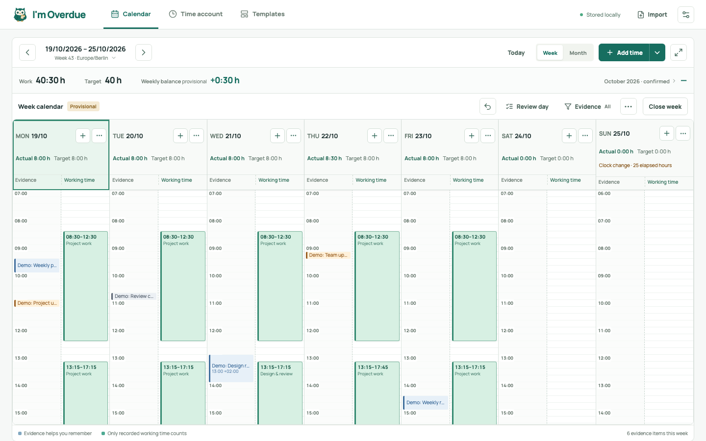

<p align="center"></p>

<h1 align="center">I'm Overdue</h1>

<p align="center"><strong>Your work. Your time. A clearer week.</strong></p>

<p align="center">
  <a href="https://github.com/ill-yes/im-overdue/actions/workflows/ci.yml"></a>
  <a href="LICENSE"></a>
  <a href="#start-locally"></a>
</p>

<p align="center">
  <a href="docs/docker.md"></a>
  <a href="README.de.md"></a>
  <a href="https://buymeacoffee.com/ill_yes"></a>
</p>

<p align="center"><a href="README.md">English</a> · <a href="README.de.md">Deutsch</a></p>

<p align="center">
  <strong>Quick links</strong><br />
  <a href="#start-with-docker">🚀 Get started</a> · <a href="#screenshots">👀 Take a look</a> · <a href="#features">✨ Features</a> · <a href="#first-steps">📅 How it works</a> · <a href="#documentation">📚 Documentation</a> · <a href="#support-im-overdue">☕ Support</a>
</p>

A busy week can be hard to piece together. I'm Overdue gives your work a
clearer home: a personal time account on your own machine or server, with
your activities, recorded hours and balance in one place.

Compare activity from your calendar, Slack and GitHub exports with the working
time you record yourself. Import normalized JSON/CSV files from your own
exporters; the app does not connect to those services’ APIs. No cloud service,
service credentials or automatic tracking.

## Screenshots



*The real app with synthetic example data. Imported activities help you remember;
you record working time yourself.*

## Features

- **📅 See your week clearly.** Week and month calendars, precise time entry and
  reusable templates.
- **⚖️ Keep your balance.** An opening balance, editable payouts and corrections,
  with confirmed, open and future amounts kept separate.
- **🌿 Plan absences.** Combine vacation, time off in lieu and sickness; dated German
  state holiday rules and individual exceptions respect your working-time target.
- **🔌 Bring your evidence.** Named data sources with JSON/CSV assignment, previews
  and import history.
- **📄 Take your records with you.** Printable timesheets with an optional account
  section, separate account CSV and SQLite backups.
- **Choose your language.** English by default, with **English / Deutsch** on the
  login page and in settings.
- **Host it yourself.** One Docker container for the UI, API and SQLite; AMD64
  and ARM64 supported.

## Start with Docker

Install Docker with Compose, then run these commands in your checkout:

```sh
cp .env.example .env
chmod 600 .env
```

Edit `.env`: set `IM_OVERDUE_ORIGIN` to the exact browser address, for example
`http://192.168.1.20:4317`, and choose a unique `IM_OVERDUE_PASSWORD` of 12–256
characters. Single-quote the password in `.env` to preserve `$` and `#` literally.

```sh
docker compose up -d --build
```

Open the configured address and sign in. Data is stored in `./appdata`, separate
from local development data. Use HTTPS through your reverse proxy for remote
access; HTTP sends your password and data without encryption.

See the [Docker and Unraid guide](docs/docker.md) for permissions, HTTPS,
password changes, updates, backups and offline restore.

## Start locally

Requires Node.js 24 or newer and npm:

```sh
npm ci
npm run dev
```

Open `http://127.0.0.1:4317`. The default local mode listens only on loopback and
does not require a password. For a production build, run `npm run build` followed
by `npm start`. See [development](docs/development.md) for configuration and tests.

## First steps

1. Check your time zone, weekly target and working days in settings. If applicable,
   add your German state under **Public holidays** and review local exceptions.
2. Set an opening date and balance under **Time account → Hours account** if you
   want a running account. Zero is a valid starting balance.
3. Record your first work block and any **Absences** in the calendar. You can
   start without importing anything.
4. Review and close completed weeks, then export a timesheet when needed.

**Optional: bring your evidence.** Create named data sources, analyze an activity
file, assign its source types and review the preview before saving. Activities
help you remember; they never create working time automatically.

Follow the [working-day guide](docs/usage.md#record-a-working-day) for the detailed
steps, including quick entry, breaks and precise times.

## Documentation

Start with what you want to do:

- **🚀 Install and self-host:** [Docker and Unraid](docs/docker.md).
- **📅 Record and review your time:** [Using I'm Overdue](docs/usage.md).
- **⚖️ Manage your account and absences:** [Hours account](docs/usage.md#hours-account),
  [absences](docs/usage.md#absences) and [public holidays](docs/usage.md#public-holidays).
- **🔌 Prepare activity imports:** [JSON/CSV format and exporter guide](docs/import-format.md).
- **🛠️ Develop and contribute:** [Development](docs/development.md).

The [documentation home](docs/README.md) brings these paths together, with quick
links to help you find a solution when you need one.

## License

I'm Overdue is source-available under the
[PolyForm Noncommercial License 1.0.0](LICENSE)
(`PolyForm-Noncommercial-1.0.0`), not OSI-approved open-source software. The license
permits noncommercial use, changes and redistribution under its terms.

See [NOTICE](NOTICE) for required notices, [commercial licensing](COMMERCIAL-LICENSE.md)
for uses outside the standard license, and [contributing](CONTRIBUTING.md) for
contribution terms.

## Support I'm Overdue

Found a bug, have an idea, or want to help improve the app? Head to
[GitHub Issues](https://github.com/ill-yes/im-overdue/issues), or read the
[contribution guide](CONTRIBUTING.md).

If I'm Overdue makes your week a little easier, you can buy me a coffee.
Support is entirely optional. Thank you for spending some of your time here.

[](https://buymeacoffee.com/ill_yes)
